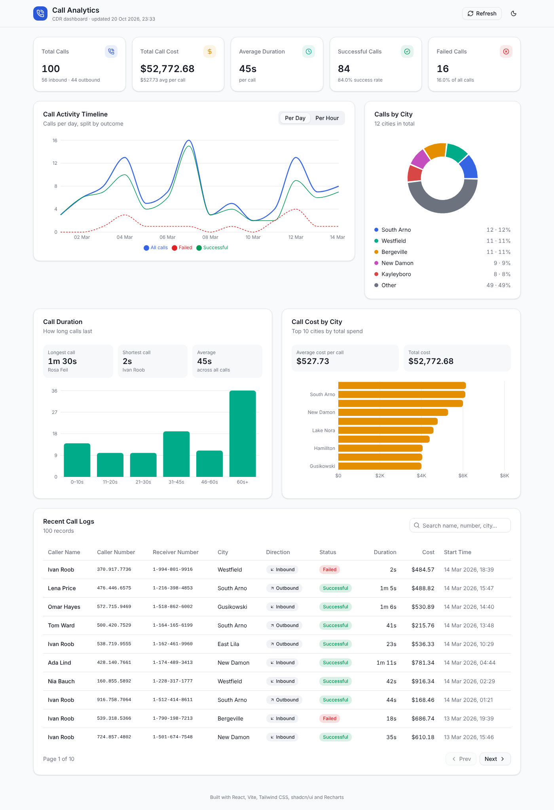
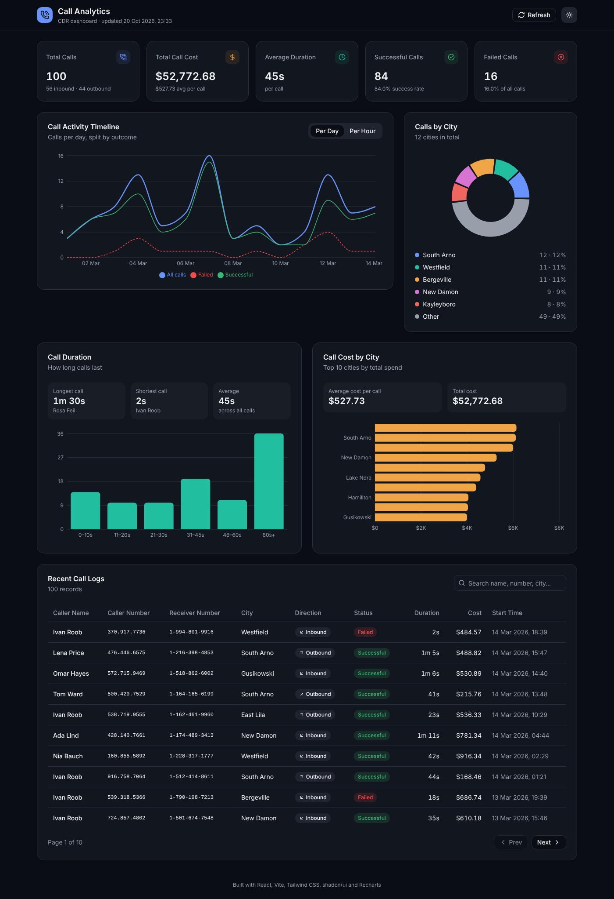

# 📞 Call Analytics Dashboard (CDR Analysis)

A SaaS-style analytics dashboard that consumes a **Call Data Record (CDR) API** and turns raw call records into KPIs, charts and a searchable call log.

Built for **London Success Academy – Software Development Internship, Week 2 / Assignment 2**.

🔗 **Live demo:** https://YOUR-PROJECT.vercel.app  ← replace after deploying
📦 **Repository:** https://github.com/YOUR-USERNAME/cdr-dashboard

---

## ✨ Features

| # | Requirement | Implementation |
|---|-------------|----------------|
| 5.1 | KPI Summary Cards | Total calls, total cost, average duration, successful & failed calls (shadcn `Card`) with inbound/outbound split and success rate |
| 5.2 | Call Duration Analytics | Longest / shortest / average tiles + duration-distribution **bar chart** |
| 5.3 | Call Cost Analytics | Total cost by city (top 10, horizontal **bar chart**) + average cost per call |
| 5.4 | Call Activity Timeline | **Line chart** with a toggle: calls per day (all / successful / failed) or calls per hour |
| 5.5 | Calls by City | **Donut (pie) chart** of top 5 cities + "Other", with percentages |
| 5.6 | Recent Call Logs | shadcn `Table`, newest first, search, pagination, status & direction badges |
| Extra | UX | Loading skeletons, error state with retry, refresh button, dark mode, responsive layout |

## 🧰 Technology Stack

- **React 19** + **Vite** – UI library and build tool
- **Tailwind CSS v4** – utility-first styling (`@tailwindcss/vite` plugin)
- **shadcn/ui** – Card, Table, Badge, Button, Input, Skeleton components
- **Recharts** – Bar, Line and Pie charts
- **lucide-react** – icons
- **Vercel** – hosting

## 📸 Screenshots




## 🚀 Getting Started

```bash
git clone https://github.com/YOUR-USERNAME/cdr-dashboard.git
cd cdr-dashboard
npm install
npm run dev        # http://localhost:5173
npm run build      # production build into /dist
```

Optional: point to a different API by creating `.env`:

```
VITE_API_URL=https://69b30b45e224ec066bdb55a0.mockapi.io/api/v1/cdr
```

## 🗂️ Project Structure

```
src/
├── main.jsx                 # React entry point
├── App.jsx                  # Page layout, wires data -> analytics -> components
├── index.css                # Tailwind + shadcn theme tokens (light/dark)
├── hooks/useCallData.js     # Fetches API data (loading / error / refetch)
├── lib/
│   ├── api.js               # fetch + normalise raw API records
│   ├── analytics.js         # pure functions: KPIs, groupings, chart data
│   ├── format.js            # currency / duration / date formatting
│   └── utils.js             # cn() class-name helper (shadcn)
└── components/
    ├── ui/                  # shadcn/ui components
    └── dashboard/           # one component per dashboard section
```

## ☁️ Deployment (Vercel)

1. Push the repo to GitHub.
2. On https://vercel.com → **Add New → Project** → import the repo.
3. Framework preset: **Vite** (build `npm run build`, output `dist`).
4. Click **Deploy** and paste the URL into this README.

## 📄 API

`GET https://69b30b45e224ec066bdb55a0.mockapi.io/api/v1/cdr`

`callDirection: true` = inbound, `false` = outbound · `callStatus: true` = successful, `false` = failed · `callDuration` in seconds · `callCost` arrives as a string and is parsed to a number.
